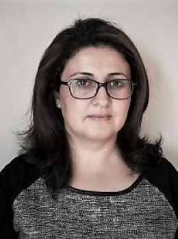

{.profile-photo width=150 fig-alt="Sana Ben Hamida"}

[**Université Paris Nanterre**](https://www.parisnanterre.fr) — UFR SEGMI, département Mathématiques et Informatique\
[**LAMSADE**](https://www.lamsade.dauphine.fr) (UMR CNRS 7243), [Université Paris Dauphine–PSL](https://dauphine.psl.eu) — chercheuse associée

::: {.profile-links}
[Profil Dauphine–PSL](https://dauphine.psl.eu/recherche/cvtheque/ben-hamida-sana)
[ORCID](https://orcid.org/0000-0003-4202-613X)
[HAL](https://cv.hal.science/sana-ben-hamida)
[Google Scholar](https://scholar.google.com/citations?user=mVT5Lk0AAAAJ)
[dblp](https://dblp.org/pid/82/2414.html)
[ResearchGate](https://www.researchgate.net/profile/Sana-Ben-Hamida-2)
:::

## Présentation

Mes recherches se situent à l'interface du **calcul évolutionnaire** et de l'**apprentissage automatique**.
Je développe des méthodes d'apprentissage évolutionnaire — programmation génétique, échantillonnage
actif et adaptatif, apprentissage d'ensemble, approches hybrides — capables de passer à l'échelle sur
des données volumineuses, de grande dimension et déséquilibrées. Depuis 2022, ces travaux portent
principalement sur la **bio-informatique, l'environnement et la santé** : prédiction de la qualité
écologique des milieux marins à partir de données d'ADN environnemental et de microbiome, prédiction
des maladies inflammatoires chroniques de l'intestin, avec une attention particulière à
l'**explicabilité** des modèles.

Docteure de l'**École polytechnique** (2001, sous la direction de Marc Schoenauer) et habilitée à
diriger des recherches (**Université Paris Dauphine–PSL**, 2024, [tel-05787780](https://hal.science/tel-05787780)), je compte plus de 25 ans
d'expérience dans l'enseignement supérieur, de la licence au doctorat.

::: {.keyfigures}

<b>6</b>thèses co-encadrées (4 soutenues)

<b>41</b>publications avec comité de lecture (revues, chapitres, conférences internationales)

<b>1</b>ouvrage de référence (ISTE–Wiley, 2017)

<b>13</b>articles dans des conférences CORE A/B

<b>2</b>prix de meilleur article (ICIKS 2023, KES 2018)

<b>5</b>jurys de thèse (dont 4 comme rapporteure)

:::

## Actualités

- **Octobre 2026** — Coordination de l'axe « L'IA comme levier de résilience écologique », [colloque international IEEE AIDIST 2026](https://forumtunisieneducation.org/programme-du-colloque-aidist-2026-intelligence-artificielle/), Gammarth, Tunisie, 29–31 octobre 2026 ; présidence de la séance 1.
- **Avril 2026** — Soutenance de thèse de Houria Braikia sur l'apprentissage multi-paradigmes pour la qualité écologique marine ([page de soutenance](https://dauphine.psl.eu/formations/doctorat/soutenances/soutenance/application-de-techniques-dapprentissage-automatique-multi-paradigmes-pour-predire-la-qualite-ecologique-des-environnements-marins-a-laide-de-donnees-dadn-environnemental)).
- **2026** — Notre prépublication *Explainable AI for marine ecological quality prediction* ([hal-05046103](https://hal.science/hal-05046103)) est recommandée par [**Peer Community In Genomics**](https://genomics.peercommunityin.org).
- **2025** — Début de la thèse de Soumaya Sabbehi sur le machine learning multimodal et les graphes de connaissances pour la maladie de Crohn (cotutelle Dauphine–PSL / École Polytechnique de Tunisie).

## Contact

sbenhami [at] parisnanterre.fr
