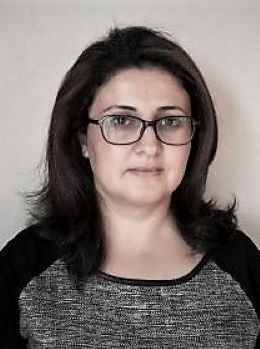

{.profile-photo width=150 fig-alt="Sana Ben Hamida"}

[**Université Paris Nanterre**](https://www.parisnanterre.fr) — UFR SEGMI, Department of Mathematics and Computer Science\
[**LAMSADE**](https://www.lamsade.dauphine.fr) (UMR CNRS 7243), [Université Paris Dauphine–PSL](https://dauphine.psl.eu) — associate researcher

::: {.profile-links}
[Dauphine–PSL profile](https://dauphine.psl.eu/recherche/cvtheque/ben-hamida-sana)
[ORCID](https://orcid.org/0000-0003-4202-613X)
[HAL](https://cv.hal.science/sana-ben-hamida)
[Google Scholar](https://scholar.google.com/citations?user=mVT5Lk0AAAAJ)
[dblp](https://dblp.org/pid/82/2414.html)
[ResearchGate](https://www.researchgate.net/profile/Sana-Ben-Hamida-2)
:::

## About

My research lies at the interface of **evolutionary computation** and **machine learning**.
I develop evolutionary learning methods — genetic programming, active and adaptive sampling,
ensemble and hybrid approaches — that scale to large, high-dimensional and imbalanced data.
Since 2022, this work has focused on **bioinformatics, environment and health**: predicting
the ecological quality of marine environments from environmental DNA and microbiome data,
predicting inflammatory bowel diseases, with particular attention to the **explainability** of models.

I received my PhD from **École polytechnique** (2001, advisor: Marc Schoenauer) and my
habilitation (HDR) from **Université Paris Dauphine–PSL** (2024, [tel-05787780](https://hal.science/tel-05787780)). I have more than 25 years
of experience in higher education, from bachelor to doctoral level.

::: {.keyfigures}

<b>6</b>PhD theses co-supervised (4 defended)

<b>41</b>peer-reviewed publications (journals, book chapters, international conferences)

<b>1</b>reference book (ISTE–Wiley, 2017)

<b>13</b>papers in CORE A/B conferences

<b>2</b>best paper awards (ICIKS 2023, KES 2018)

<b>5</b>PhD juries (4 as reviewer)

:::

## News

- **October 2026** — Coordination of the track *AI as a lever for ecological resilience*, [IEEE AIDIST 2026 international conference](https://forumtunisieneducation.org/programme-du-colloque-aidist-2026-intelligence-artificielle/), Gammarth, Tunisia, 29–31 October 2026; chair of session 1.
- **April 2026** — Houria Braikia defended her PhD on multi-paradigm machine learning for marine ecological quality ([defence page](https://dauphine.psl.eu/formations/doctorat/soutenances/soutenance/application-de-techniques-dapprentissage-automatique-multi-paradigmes-pour-predire-la-qualite-ecologique-des-environnements-marins-a-laide-de-donnees-dadn-environnemental)).
- **2026** — Our preprint *Explainable AI for marine ecological quality prediction* ([hal-05046103](https://hal.science/hal-05046103)) was recommended by [**Peer Community In Genomics**](https://genomics.peercommunityin.org).
- **2025** — Start of the PhD of Soumaya Sabbehi on multimodal machine learning and knowledge graphs for Crohn's disease (cotutelle Dauphine–PSL / École Polytechnique de Tunisie).

## Contact

sbenhami [at] parisnanterre.fr
